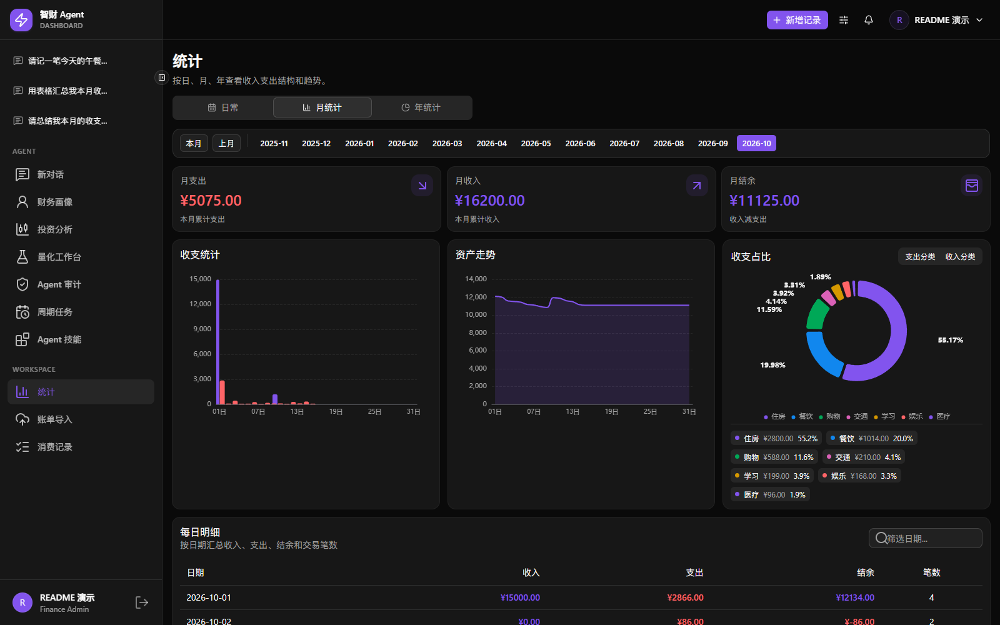
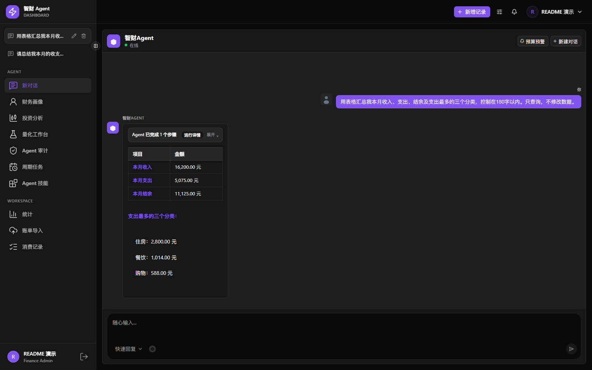
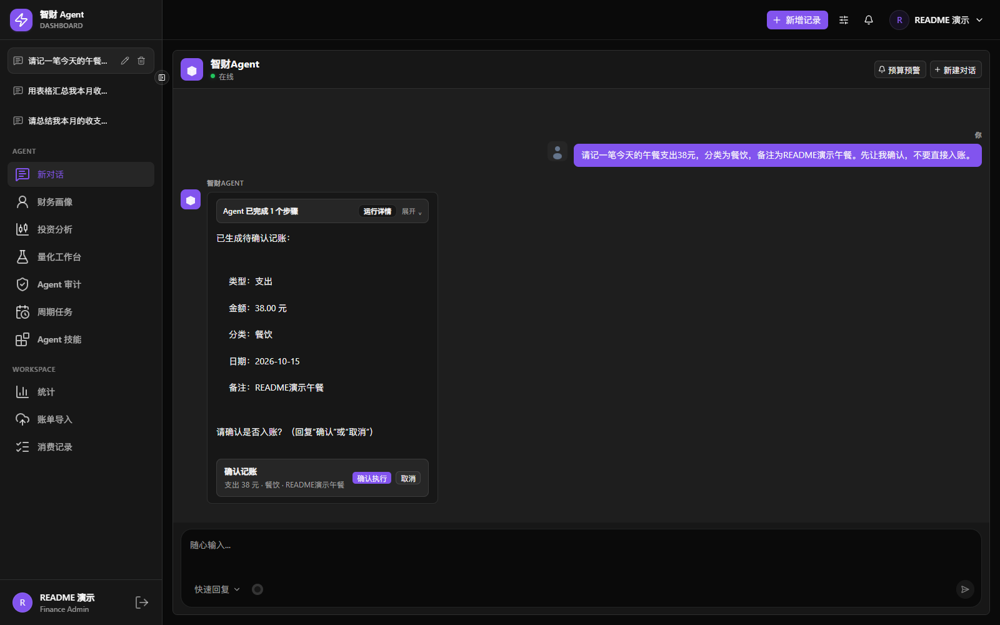
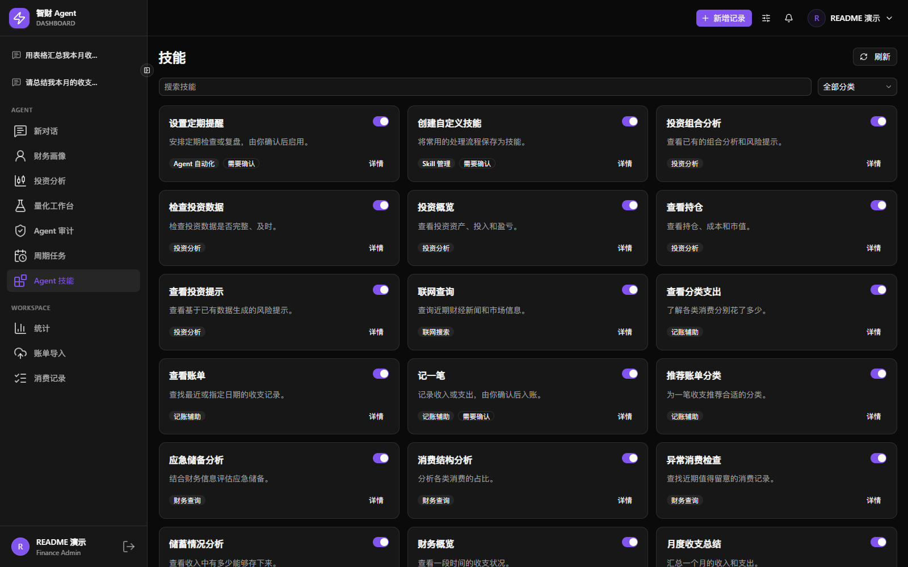
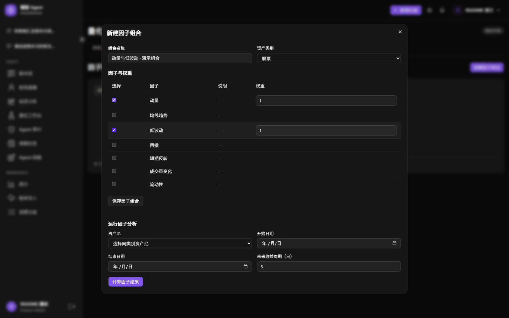

# 智财 Agent · Smart Finance Agent

**基于 AI Agent 的个人财务管理与自主投资研究平台**

智财 Agent 面向具有财务管理意识、希望管理个人收支并开展股票、ETF 和基金自主研究的个人用户，以财务数据为基础、AI Agent 为财务交互和任务执行入口，将账务管理、财务分析、资产信息与投资研究集中到统一的工作台。

平台由个人财务管理、Agent 助手和投资研究三部分组成，覆盖日常账务整理、自然语言查询、经确认的财务操作，以及建设中的策略研究、回测与模拟交易流程。

> **开发中：** 项目尚未达到上线标准。Agent 持续完善，量化工作台正在重构，安全与账号验证等配套能力尚未完成。详见 [开发状态](#开发状态)。

[面向用户](#面向用户) · [平台组成](#平台组成) · [界面展示](#界面展示) · [开发状态](#开发状态) · [本地运行](#本地运行) · [服务器部署](#服务器部署) · [开发文档](#开发文档)



## 面向用户

核心用户是具有财务管理意识、关注股票或基金投资，并希望借助 AI 和数据工具提高管理与研究效率的个人投资者。

| 用户 | 主要使用场景 |
| --- | --- |
| 个人投资者 | 整理收入与支出、管理预算、跟踪资产、进行日常财务复盘 |
| 自主投资研究爱好者 | 整理市场数据、研究投资方案、配置策略并关注回测与模拟结果 |
| 金融与计算机相关专业学生、开发者 | 学习财务业务、金融数据处理及 Agent 工具集成，参与功能开发 |

## 平台组成

### 个人财务管理

围绕账目、预算和财务目标组织个人财务信息。

- **账务记录：** 收入与支出管理、分类、筛选和账目查询。
- **账单导入：** 从支付流水截图提取候选交易，经人工核对后入账。
- **财务统计：** 按日、月、年查看收支趋势、结余和分类占比。
- **财务画像：** 管理收入、固定支出、预算、储蓄目标与风险偏好。

### Agent 财务助手

通过自然语言查询业务数据、调用财务工具和办理明确的财务任务。

- **工具调用：** 查询账目、汇总消费、查看预算及已有投资信息。
- **操作确认：** 记账、预算设置等关键写操作提交用户确认。
- **运行记录：** 查看对话历史、工具步骤与执行过程。
- **工作流管理：** 长期记忆、Skills 和周期任务持续完善，支持常用财务流程的维护与复用。

### 金融数据与投资研究

金融数据中心按实际需求组织行情采集，围绕产品类型管理数据契约、来源、标准化与采集记录，为个人资产管理和研究任务准备数据。

量化工作台围绕资产池、因子组合、策略配置、训练、回测、结果比较和模拟组合组织研究流程。当前以数据拉取和工作台重构为主，进一步的量化分析及 Agent 接入尚未完成。

## 界面展示

截图采集于 2026-10-15，使用独立演示账号与示例账目。界面中的 Logo 为暂用设计。

### Agent 收支查询

通过自然语言查询本月收入、支出、结余和主要消费分类，并查看运行步骤。



### 待确认记账

核对金额、分类、日期和备注后，选择执行或取消。图中午餐记录尚未入账。



<details>
<summary>Agent Skills</summary>

按财务场景管理技能，查看使用方式、启停状态与调用记录。



</details>

<details>
<summary>量化工作台 · 因子配置</summary>

重构中的因子组合编辑器，图中选择了动量与低波动因子，尚未提交研究任务。



</details>

## 开发状态

| 模块 | 当前进度 |
| --- | --- |
| Agent | 类 Hermes Agent 的能力持续开发，工具编排、记忆、Skills、周期任务和交互体验仍在完善 |
| 金融数据与分析 | 当前主要实现数据拉取，相关分析尚缺乏科学依据与有效性验证 |
| 量化工作台 | 正在重构，进一步的量化分析尚未完成重构，尚未接入 Agent |
| 安全与上线准备 | 面向上线的安全技术引入与系统性安全建设尚未开展 |
| 登录与注册 | 已有基础页面和接口，验证码、接码等验证流程尚未实现 |
| 品牌与界面 | 产品 Logo 尚未确定，界面与其他功能持续开发 |

当前版本用于本地开发与演示，投资分析结果不用于实际投资决策。

## 本地运行

以下为本地开发环境的启动步骤，命令以 Windows PowerShell 为例，从项目根目录开始执行。

### 1. 准备依赖

| 依赖 | 要求或用途 |
| --- | --- |
| Java / Maven | JDK 17+，Maven 3.8+ |
| Node.js / npm | Node.js 22.12+，使用 npm 安装前端依赖 |
| Python | Python 3.12+，安装 `analysis-service/requirements.txt` |
| MySQL | MySQL 8.0+，保存业务数据 |
| Redis | 建议配置，用于缓存、限流和账单确认协调 |
| DashScope | 配置 API Key；图片识别还需配置可用的视觉模型名 |
| Tavily | 可选，用于联网搜索 |

当前 NumPy、SciPy 依赖要求 Python 3.12+。聊天、图片识别和联网搜索使用外部服务，可能产生相应服务费用。

### 2. 创建数据库并配置后端

在 MySQL 中执行：

```sql
CREATE DATABASE smart_finance
  DEFAULT CHARACTER SET utf8mb4
  COLLATE utf8mb4_unicode_ci;
```

新建 `backend/src/main/resources/application-local.yml`，填入本机配置。该文件已被 Git 忽略；也可参考根目录的 [env.example](env.example)。

```yaml
spring:
  datasource:
    username: 你的数据库用户名
    password: "你的数据库密码"

jwt:
  secret: "替换为至少32字节的随机密钥"

langchain4j:
  dashscope:
    api-key: "你的DashScope API Key"

bill:
  ai:
    multimodal-model: "你的DashScope视觉模型名"
```

默认连接本机 `smart_finance` 数据库；地址不同时补充 `spring.datasource.url`。视觉模型也可通过 `DASHSCOPE_VL_MODEL` 环境变量配置。需要联网搜索时配置 `TAVILY_API_KEY` 或 `search.api-key`。

### 3. 在三个独立终端启动服务

**终端一：分析服务**

```powershell
cd analysis-service
py -3.12 -m venv .venv
.\.venv\Scripts\python.exe -m pip install -r requirements.txt
.\.venv\Scripts\python.exe -m uvicorn app.main:app --host 127.0.0.1 --port 8090
```

**终端二：后端**

```powershell
cd backend
mvn spring-boot:run "-Dspring-boot.run.profiles=mysql"
```

MySQL 模式启动时，Flyway 按顺序应用尚未执行的迁移。不要修改已经执行的迁移，也不要在已有数据库中手动重复导入建表 SQL。

**终端三：前端**

```powershell
cd frontend
npm ci
npm run dev
```

打开 [http://localhost:3000](http://localhost:3000)，注册自己的账号后登录。默认后端端口为 `8080`，分析服务为 `8090`；服务健康检查、端口调整和共享令牌配置见 [开发与运行说明](DEVELOPMENT.md)。

## 服务器部署

使用 Docker Compose 在单台 Linux 服务器部署。Caddy 提供前端页面、API 代理和自动 HTTPS，Java 后端、Python 分析服务、MySQL 与 Redis 通过容器网络通信。

### 1. 准备环境

- Linux x86_64 服务器，安装 [Docker Engine](https://docs.docker.com/engine/install/)、[Docker Compose 插件](https://docs.docker.com/compose/install/linux/)、Git、Bash 和 OpenSSL。
- 将自己的域名解析到服务器公网 IP，开放 TCP 80、443，并确保端口未被其他服务占用。配置了 AAAA 记录时，IPv6 也需可达。
- 服务器需能访问 Docker 镜像仓库、Maven、npm 和 Python 依赖源。镜像在服务器上串行构建，需预留构建所需的内存与磁盘空间。

以下命令在服务器上以 root 身份执行。示例域名 `finance.example.com` 替换为自己的域名。

```bash
docker version
docker compose version
git clone https://github.com/zhenxinxiaocheng/smart_finance_agent.git /opt/smart-finance-agent
cd /opt/smart-finance-agent
```

服务器无需单独安装 Java、Node.js、Python、MySQL 或 Redis，这些运行环境由镜像提供。

### 2. 设置域名

将 [deploy/runtime/start.sh](deploy/runtime/start.sh) 中的 `export SERVER_DOMAIN=...` 修改为：

```bash
export SERVER_DOMAIN=finance.example.com
```

该值由脚本直接设置，需要修改文件中的这一行。然后将 [Caddyfile](deploy/runtime/Caddyfile) 的站点首行改为 `{$SERVER_DOMAIN} {`，删除原有的固定 IP 入口，完整配置如下：

```caddyfile
{$SERVER_DOMAIN} {
    handle /api/* {
        reverse_proxy backend:8080
    }
    handle {
        root * /srv
        encode zstd gzip
        try_files {path} /index.html
        file_server
    }
}
```

Caddy 自动申请和续期证书，具体要求见 [自动 HTTPS 文档](https://caddyserver.com/docs/automatic-https)。

### 3. 创建应用配置

```bash
install -d -m 700 .data/deploy
openssl rand -hex 32
```

新建 `.data/deploy/application-local.yml`，将上一条命令生成的随机值填入 `jwt.secret`，并填写自己的 API Key 和可用的视觉模型名：

```yaml
jwt:
  secret: "生成的随机密钥"

langchain4j:
  dashscope:
    api-key: "你的DashScope API Key"

bill:
  ai:
    multimodal-model: "你的DashScope视觉模型名"

search:
  api-key: ""
```

不使用联网搜索时，将 `search.api-key` 设置为 `""`。数据库、Redis 和分析服务连接由 Compose 配置，无需在此填写本地数据库账号。

如使用 `${DASHSCOPE_API_KEY}` 等环境变量占位符，需同时在 [compose.yaml](deploy/runtime/compose.yaml) 中为对应容器配置该变量；默认配置不会自动将宿主机的模型密钥传入容器。

### 4. 初始化并启动

```bash
cd /opt/smart-finance-agent
chmod 600 .data/deploy/application-local.yml
bash deploy/runtime/start.sh prepare "$PWD"
bash deploy/runtime/start.sh up "$PWD"
```

`prepare` 生成数据库密码和分析服务内部令牌，保存在 `.data/deploy/.env`；重复执行保留已有凭据。JWT 密钥和模型 Key 使用上一步的 YAML 配置。

`up` 检查配置，按分析服务、后端、前端的顺序构建镜像，启动容器并等待健康检查，等待上限为 360 秒。MySQL 首次启动创建业务数据库和账号，后端通过 Flyway 应用数据库迁移。

启动后访问 `https://finance.example.com`，注册账号并登录。

### 5. 状态检查与日常管理

在项目根目录设置以下管理函数。新开终端后需重新执行，域名与 `start.sh` 保持一致：

```bash
cd /opt/smart-finance-agent
export PROJECT_DIR="$(pwd -P)"
export RUNTIME_DIR="$PROJECT_DIR/deploy/runtime"
export CONFIG_FILE="$PROJECT_DIR/.data/deploy/application-local.yml"
export SERVER_DOMAIN=finance.example.com
sfa() {
  docker compose -p smart-finance-agent \
    --env-file "$PROJECT_DIR/.data/deploy/.env" \
    -f "$RUNTIME_DIR/compose.yaml" "$@"
}
sfa config --quiet
sfa ps
sfa logs --tail=100 backend analysis web
curl -I "https://$SERVER_DOMAIN"
curl -s -o /dev/null -w '%{http_code}\n' "https://$SERVER_DOMAIN/api/auth/me"
```

未登录访问 `/api/auth/me` 返回 `401`。如 HTTPS 无法访问，检查域名解析、80/443 端口和 `sfa logs --tail=100 web`。

`sfa stop` 停止服务；`sfa down` 移除容器但保留命名卷。对外仅映射 Web 的 80、443 端口，其余服务不映射主机端口。

### 6. 更新与备份

保存自定义域名设置后拉取新版本。如 Git 提示部署文件存在本地冲突，先合并自定义配置，再启动更新：

```bash
cd /opt/smart-finance-agent
git pull --ff-only &&
bash deploy/runtime/start.sh up "$PWD"
```

原 MySQL 容器运行时，脚本会暂停 Web、后端和分析服务，将数据库导出到 `.data/deploy/backups/`，然后构建并启动新版本，更新期间服务会中断。备份或构建失败时，脚本尝试恢复原容器并中止更新。启动失败不自动回滚已迁移的数据库。

| 保存位置 | 数据 |
| --- | --- |
| `.data/deploy/application-local.yml`、`.data/deploy/.env` | 应用配置、数据库密码与内部令牌 |
| `.data/deploy/backups/` | 更新时生成的 MySQL 备份 |
| `mysql-data`、`redis-data` | 数据库与 Redis 持久化数据 |
| `analysis-data`、`uploads` | 分析快照、模型文件与上传账单 |
| `caddy-data`、`caddy-config` | HTTPS 证书与 Caddy 状态 |

备份时同时保存应用配置和需要保留的命名卷数据。脚本的自动备份仅覆盖运行中的 MySQL，不包含上传文件、分析文件和证书，未配置定时或异地备份。已有数据库部署需保留原 `.env` 凭据；勿执行 `down -v` 删除运行数据。

## 技术与模块

| 模块 | 技术 |
| --- | --- |
| 前端 | Vue 3、Vite 8、Pinia、Tailwind CSS 4、Reka UI、ECharts 6 |
| 后端 | Java 17、Spring Boot 3.2、MyBatis-Plus、MySQL、Flyway、Redis |
| 分析服务 | Python、FastAPI、Pandas、NumPy、SciPy、scikit-learn、XGBoost、Optuna |
| Agent | LangChain4j、DashScope、ReAct 工具调用、SSE |

Vue 负责页面交互与可视化，Java 后端负责业务数据、权限、事务和任务状态，Python 分析服务负责数据适配与计算。各模块通过接口协作，业务数据由后端统一持久化。

## 开发文档

- [开发与运行说明](DEVELOPMENT.md)：目录、配置、页面与接口入口、验证命令及常见启动问题。
- [分析服务](analysis-service/README.md)：来源适配、采集进程与数据质量规则。
- [量化工作台后端](backend/src/main/java/com/smartfinance/agent/investment/quant/workbench/README.md)：模块职责、调用边界与测试入口。
- [市场数据规则与存储](backend/src/main/java/com/smartfinance/agent/investment/marketdata/README.md)：共享数据契约、采集事实与升级规则。

## 反馈与贡献

欢迎通过 [Issues](https://github.com/zhenxinxiaocheng/smart_finance_agent/issues) 提交问题反馈、功能建议和使用体验。问题反馈请附复现步骤、预期与实际表现、相关版本和脱敏日志，勿上传密钥或真实账单。

提交改动前请运行与变更相关的检查，命令见 [开发文档](DEVELOPMENT.md#验证命令)。涉及业务行为的修复应附能够复现问题的测试；架构或数据结构调整建议先通过 Issue 讨论。

## 许可证

仓库目前未提供许可证文件，使用、修改与分发的授权条件尚未明确；请先联系维护者确认。
